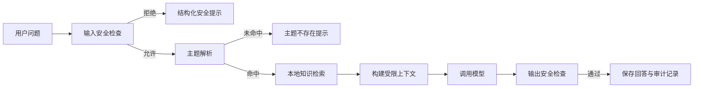

# Biomedical Agent Demo

一个可独立运行的生物医学知识问答 demo。它先检查请求的安全边界，再从项目内知识库检索证据，调用 OpenAI 兼容模型生成回答，并保存可审计的运行记录。

> 本项目仅用于技术演示和一般医学知识学习，不能替代医生、医学指南或正式临床决策系统。不要输入真实患者隐私数据。

## 功能概览

- 本地知识库主题解析与受限片段检索；
- 高风险生物请求、个体化诊断和用药调整拦截；
- 支持 `chat_completions` 与 `responses` 两种 OpenAI 兼容接口；
- 模型输出二次安全检查、长度限制和幂等写入；
- JSONL 运行轨迹与 token 用量汇总；
- 不访问外部模型的单元测试和离线评测。

## 快速开始

环境要求：Python 3.10 或更高版本。

```powershell
cd C:\Users\admin\Documents\code\biomedical-agent-demo

python -m venv .venv
.\.venv\Scripts\Activate.ps1
python -m pip install -r requirements.txt

Copy-Item .env.example .env
notepad .env
```

在 `.env` 中填写模型服务的真实配置后，先检查连接：

```powershell
python llm_smoke_test.py
```

再运行一个问答：

```powershell
python biomedical_agent.py "PCR 是什么？"
```

程序返回 JSON；成功时回答会写入 `outputs/summaries.txt`，运行轨迹会写入 `outputs/trace.jsonl`。

## 模型配置

| 变量 | 说明 | 示例 |
|---|---|---|
| `BIOMEDICAL_LLM_API_STYLE` | 接口风格 | `chat_completions` 或 `responses` |
| `BIOMEDICAL_LLM_BASE_URL` | OpenAI 兼容接口地址 | `https://your-provider.example/v1` |
| `BIOMEDICAL_LLM_MODEL` | 模型 ID | 由模型服务商提供 |
| `BIOMEDICAL_LLM_API_KEY` | API Key | 只保存在本地 `.env` |

`.env` 已加入 `.gitignore`。项目只提供 `.env.example`，不会携带真实密钥。

## 使用示例

```powershell
# 常规知识问题
python biomedical_agent.py "DNA 是什么？"
python biomedical_agent.py "请介绍单细胞 RNA 测序"
python biomedical_agent.py "免疫学研究什么？"

# 调整检索片段和回答长度
python biomedical_agent.py "CRISPR 是什么？" --max-chars 300 --max-output-tokens 512 --max-output-chars 1500

# 汇总模型调用和 token 用量
python usage_report.py
```

安全策略会在模型调用前拦截个体化诊断、直接用药调整、患者隐私泄露和高风险病原体请求。超出本地知识库范围的问题会返回结构化错误，不会调用模型。

## 项目结构

```text
biomedical-agent-demo/
├─ biomedical_agent.py          # 命令行入口和流程编排
├─ agent_fourday.py             # 检索、模型调用、审计与写入
├─ biomedical_config.py         # 项目内相对路径和主题别名
├─ biomedical_kb.py             # 知识库解析与主题匹配
├─ biomedical_policy.py         # 输入/输出安全策略
├─ context_builder.py           # 证据与模型上下文构建
├─ llm_client.py                # OpenAI 兼容模型调用层
├─ llm_smoke_test.py            # 模型连接检查
├─ usage_report.py              # token 用量汇总
├─ biomedical_eval_cases.json   # 20 条离线评测用例
├─ requirements.txt
├─ .env.example
├─ data/
│  └─ notes_long.txt            # 本地生物医学知识库
├─ outputs/                     # 运行时自动生成结果
├─ tests/
│  ├─ test_biomedical_agent.py
│  └─ run_eval_cases.py
└─ docs/
   ├─ DEMO.md
   └─ EVALUATION.md
```

所有资源路径均以代码文件所在目录为基准，因此可以整体移动或复制 `biomedical-agent-demo` 文件夹，不依赖原来的 `C:\Users\admin\Documents\code` 目录结构。

## 工作流程



## 验证

以下命令都不调用真实模型，也不需要 `.env`：

```powershell
python -m unittest discover -s tests -p "test_*.py" -v
python tests\run_eval_cases.py
```

本次打包验证结果：8 项单元测试全部通过；20 条离线评测全部通过，通过率 100%。详细范围见 [评测说明](docs/EVALUATION.md)。

## 已知边界

- 知识来源仅为 `data/notes_long.txt`，不是实时医学数据库；
- 主题解析和安全策略以规则为主，不能覆盖所有自然语言变体；
- 模型回答可能出错，项目不会给出个人诊断、处方或剂量建议；
- `summaries.txt` 与 `trace.jsonl` 会持续追加，长期运行时需自行轮转或归档；
- 接入第三方模型服务时，数据处理方式受相应服务商政策约束。

演示步骤见 [DEMO.md](docs/DEMO.md)。
